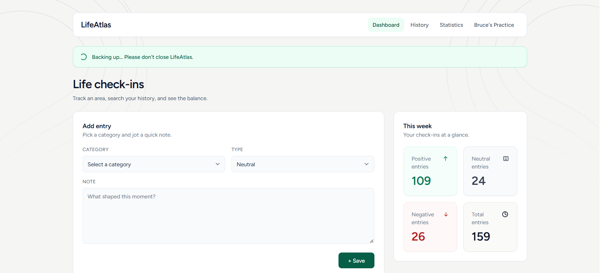
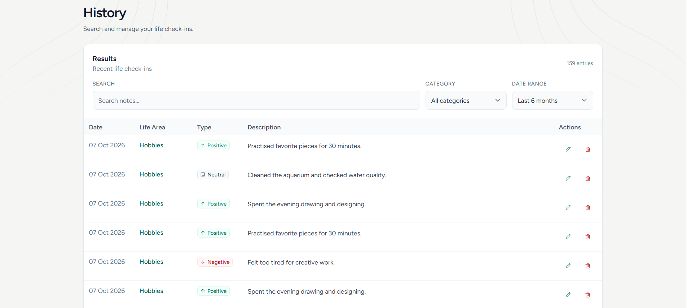
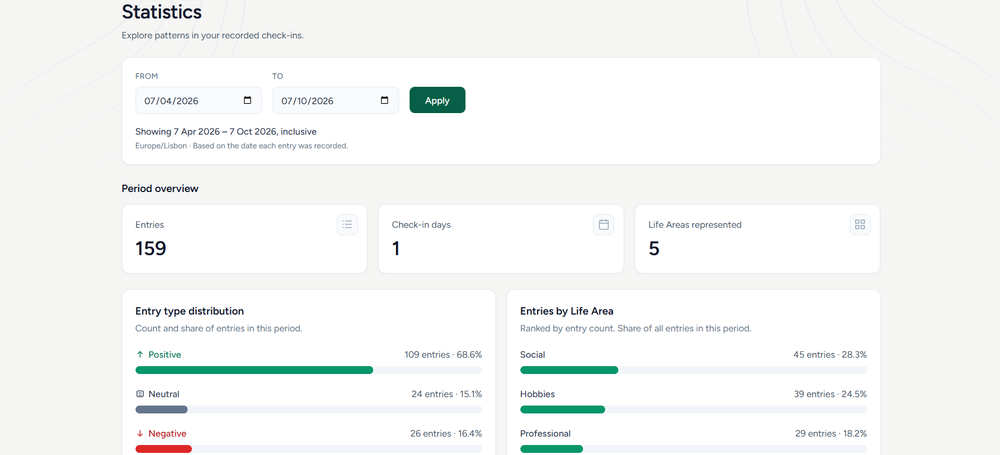
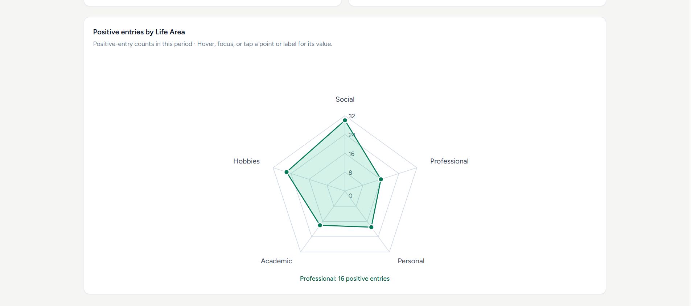

# LifeAtlas

LifeAtlas is a local-first personal development and journaling application, built for my own reflective practice. It combines structured check-ins with tools to search past entries and explore patterns over time.

This repository presents **LifeAtlas V1**, the first portfolio-ready version of the application, with a defined scope for local, single-user use.



## About the project

Each check-in contains a Life Area, a description, and a Positive, Neutral, or Negative classification.

I built LifeAtlas for my own personal development and journaling practice. A traditional notebook works well for recording thoughts, but I wanted to search and retrieve past entries, revisit specific Life Areas, and compare different periods. LifeAtlas keeps the reflective value of journaling while adding structure and ways to explore patterns that can be difficult to see across notebook pages.

History provides a way to search and revisit past entries. Statistics helps explore accumulated entries through counts, distributions, and comparisons between periods, making patterns over time easier to examine.

## Engineering & continuous learning

LifeAtlas provides a practical environment for continuing to strengthen my software-engineering practice, from database querying and background processing to interface design, testing, and reliability.

I am also studying AI and Deep Learning and exploring how LLM-assisted tools can be integrated effectively into real development workflows. Those studies complement my practical work with these tools. LifeAtlas’s product functionality remains focused on journaling and reporting, with engineering decisions and validation under my ownership.

## Core features

- **Dashboard:** create check-ins and view current-week totals by classification.
- **History:** combine description search, date presets, and Life Area filters; browse paginated results; edit entries or confirm their deletion.
- **Statistics:** apply custom date ranges to summary counts, type percentages, Life Area rankings, and a positive-entry radar chart.
- **Local database backups:** Dashboard use triggers the daily backup decision. Eligible backups run in the background to an external host directory, with visible status and retention of the latest five completed backups.

## Engineering highlights

### 1. Date-range statistics and visualization

Statistics separates draft date inputs from the currently applied range. Results change only after successful validation, keeping every reporting section aligned with the same period.

Date ranges include both selected dates. Queries start at midnight on the first date and stop before midnight following the final date. Calendar calculations use Europe/Lisbon and avoid month-subtraction overflow.

SQL aggregation calculates total entries, distinct check-in days, classification percentages, and Life Area counts without loading individual entries into application memory. Areas with no activity remain visible, and empty periods have explicit zero states.

A native SVG radar chart adapts to the available areas and data scale. Axis positions remain stable when rankings change, while Alpine.js supports pointer and keyboard interactions. The chart measures **positive-entry frequency**, rather than a scientifically validated wellbeing score.

Evidence: [Statistics component](app/Livewire/Stats.php), [radar visualization](resources/views/components/life-area-radar.blade.php), and [Statistics tests](tests/Feature/StatsTest.php).

### 2. Reliable queued local backups

Dashboard checks whether a backup is needed for the current day. Laravel’s database queue moves the dump into a background job, processed by a dedicated Docker worker.

A unique backup-date constraint, transactional coordination, and overlap protection reduce duplicate work. Backup records track pending, running, completed, and failed states.

The job reserves a unique temporary file exclusively, checks that the output is nonempty, and publishes it using an atomic hard link that never replaces an existing destination. Cleanup removes only its own temporary file. Dump diagnostics are filtered before logging, and a failed backup can be retried through a subsequent Dashboard visit.

After success, retention attempts to keep the latest five completed backups. Retention errors are handled separately so they do not invalidate a newly completed backup.

Evidence: [Dashboard trigger](app/Livewire/Dashboard.php), [backup job](app/Jobs/CreateBackup.php), [backup schema](database/migrations/2026_09_14_000000_create_backups_table.php), and [Docker services](compose.yaml).

### 3. Consistent History filtering and pagination

History combines description search, date filtering, and Life Area selection in one database query. Results use server-side pagination, with 15 entries per page and deterministic ordering by timestamp and ID.

Changing a filter resets pagination. Editing and deleting preserve active filters, and the component recovers when a change removes the final result on the current page.

Records removed while an edit or deletion dialog is open are handled gracefully. These decisions keep navigation and feedback consistent as the underlying data changes.

Evidence: [History component](app/Livewire/History.php) and [History tests](tests/Feature/HistoryTest.php).

## Screenshots

The screenshots below use fictional demo data.

### Dashboard

Check-in creation and current-week activity.


### History

Search, combined filters, classifications, and paginated results.



### Statistics

Date-range statistics, summary counts, classifications, and Life Area distribution.



Positive-entry frequency across Life Areas.



## Architecture & Tech Stack

LifeAtlas is a Laravel monolith with class-based Livewire page components and Blade views. Eloquent models connect Life Areas to check-ins through a one-to-many relationship. Filtering, pagination, and reporting queries run server-side; Alpine.js handles lightweight interface interactions.

Docker Compose separates the application, MariaDB database, and queue worker. A dedicated Node dependency volume isolates container dependencies from the host project mount.

| Layer | Technology |
|---|---|
| Language | PHP `^8.2` requirement; Sail configured for PHP 8.5 |
| Application | Laravel 12.65.0, Livewire 3.8.3, Blade |
| Interface | Alpine.js, Tailwind CSS 3.4.19, native SVG |
| Database | MariaDB 11 Docker image, Eloquent |
| Background work | Laravel database queue |
| Local environment | Docker Compose, Laravel Sail 1.65.0 |
| Frontend build | Vite 7.3.6 |
| Testing and formatting | PHPUnit 11.5.56, Laravel Pint |

Versions reflect tracked dependency lockfiles and container configuration.

## Testing

Automated feature tests cover key behavior in History, Statistics, and backup handling, including filtering and pagination, date-range reporting, and backup dispatch and failure handling. Database-backed tests use in-memory SQLite, with fakes isolating relevant external operations. The full Docker test suite passed: **52 tests, 437 assertions**.


See [feature tests](tests/Feature) and [PHPUnit configuration](phpunit.xml).

## AI-assisted development workflow

I use LLM-assisted tools for technical exploration, code analysis, solution planning, scoped implementation support, and debugging. I remain responsible for product decisions, architecture, scope, code review, testing, manual validation, and acceptance of changes.

The workflow follows:

**Problem definition → reasoning and solution design → scoped AI-assisted exploration or implementation → code inspection → automated testing → manual validation and review → Git commit**

My ongoing AI and Deep Learning studies complement this practical use by deepening my understanding of the technologies. LifeAtlas provides a software-engineering context in which to apply and evaluate that evolving approach.

## Project scope

LifeAtlas V1 is intentionally designed for local, single-user use. Its implemented scope focuses on check-ins, History, Statistics, and local data protection.

Daily backups are triggered through Dashboard use and stored locally outside the repository. The radar provides a visual comparison of positive-entry frequency across Life Areas; it is not a scientifically validated wellbeing metric.

The environment documented here is for local use.

## Running locally

### Requirements

- Git
- Docker Desktop with Docker Compose
- Compatible PHP and Composer for installing dependencies before building Sail

### 1. Clone and configure

```bash
git clone https://github.com/M-Araujo/LifeAtlas.git
cd LifeAtlas
```

Create the environment file:

```bash
cp .env.example .env
```

On PowerShell:

```powershell
Copy-Item .env.example .env
```

Configure MariaDB to use the Docker service host `mariadb`. Set the queue connection to `database` and `DB_QUEUE_RETRY_AFTER` to `720`, exceeding the worker’s 660-second timeout. Keep local credentials in `.env`.

Before starting services, complete the external backup setup below. For an existing installation, complete the manual migration before enabling the new storage.

### 2. Install PHP dependencies

With compatible PHP and Composer available locally:

```bash
composer install
```

Composer dependencies must exist before the Docker build because the configured Sail runtime is located inside `vendor`.

### 3. Start services and initialize the database

Start the application and database before the queue worker:

```bash
docker compose up -d laravel.test mariadb
docker compose exec laravel.test php artisan key:generate
docker compose exec laravel.test php artisan config:clear
docker compose exec laravel.test php artisan migrate --seed
```

The seeders create Life Areas and synthetic entries.

### 4. Build frontend assets and start the worker

```bash
docker compose exec laravel.test npm ci
docker compose exec laravel.test npm run build
docker compose up -d queue
```

Open **http://localhost** with the default port configuration.

For frontend development:

```bash
docker compose exec laravel.test npm run dev
```

### Run tests

```bash
docker compose exec laravel.test composer test
```

This clears cached configuration and runs the suite using the in-memory SQLite test configuration.

## External backup storage

Backups remain private and local on your computer, outside the repository. They use the private Laravel `backups` disk rooted at `/var/lib/lifeatlas`. Both the application and queue containers bind-mount your external host directory at `/var/lib/lifeatlas/backups`. Stored paths remain relative, such as `backups/lifeatlas-2026-10-10-12.sql`. The ordinary `local` disk is unchanged. No backup URL or public storage link is created; backups are not uploaded to a remote service.

### First-time setup

Complete these steps after copying `.env.example` to `.env` and before the first `docker compose up`. The example deliberately leaves `BACKUP_HOST_PATH` empty.

1. With `BACKUP_HOST_PATH` unset or empty, Compose uses `../LifeAtlasData/backups`, relative to the directory containing `compose.yaml`. Create that directory manually before starting Docker (for example, `mkdir -p ../LifeAtlasData/backups` on Linux/WSL2). For `/home/example/projects/LifeAtlas`, this resolves to `/home/example/projects/LifeAtlasData/backups`. Alternatively, choose an absolute external path. Nothing creates or migrates backup directories automatically.
2. Restrict host access to your account and necessary system access. On Windows, use restricted ACLs and remove unnecessary inherited access. On Linux/macOS, use restrictive directory permissions. Ensure Docker can access the directory; Docker Desktop may require file-sharing access.
3. Leave `BACKUP_HOST_PATH` empty for the default, or set it in your local `.env` to the directory you selected. Use the path syntax of the environment running Compose: forward-slash drive paths from Windows, `/mnt/c/...` from WSL2. Replace the example username with your own. Quote paths containing spaces. An exported shell variable overrides the value in `.env`.

   | Host | Example `BACKUP_HOST_PATH` | Permission mode |
   |---|---|---|
   | Windows | `C:/Users/your-user/LifeAtlasData/backups` | `host` |
   | WSL2 using a Windows folder | `/mnt/c/Users/your-user/LifeAtlasData/backups` | `host` |
   | WSL2 using its Linux filesystem | `/home/your-user/LifeAtlasData/backups` | `posix` when the worker owns the directory |
   | Native Linux | `/home/your-user/LifeAtlasData/backups` | `posix` when the worker owns the directory |
   | macOS with Docker Desktop | `/Users/your-user/LifeAtlasData/backups` | `host` |

   For example, on Windows:

   ```dotenv
   BACKUP_HOST_PATH=C:/Users/your-user/LifeAtlasData/backups
   BACKUP_PERMISSION_MODE=host
   ```

Compose uses `${BACKUP_HOST_PATH:-../LifeAtlasData/backups}` for both services, so unset and empty values select the same default. Both services use long bind-mount syntax with `create_host_path: false`; a missing source directory causes Docker startup to fail instead of being silently created. Use a current Docker Compose version that supports this option. Compose supplies `BACKUP_STORAGE_ROOT=/var/lib/lifeatlas` to both services. Laravel always writes through that container root; it does not interpret the host path. The job requires the destination to exist and be writable; it never falls back to repository storage.

Windows, WSL2 Windows mounts (`/mnt/c`) and Docker Desktop macOS mounts should use `host` permission mode: privacy comes from host ACLs or permissions, and the job does not require POSIX `chmod`. Linux and WSL2 Linux filesystems can select `posix`, which requires successful directory `chmod(0700)`, confirmation of the resulting mode, and write access. The host directory's ownership must allow the container's `sail` user to enforce those permissions; Docker Desktop permission translation may differ from native Linux. A Windows filesystem may report successful `chmod` without enforcing it; `posix` now rejects a resulting mode other than `0700`. Run queue workers as `sail`, not root. Both modes require an existing directory; invalid modes fail the backup.

WSL2 access across `/mnt/c` can be slower than access to its Linux filesystem. Keep project code and dependencies on the Linux filesystem where possible; storing backups on Windows can take longer. The dump timeout remains 600 seconds. Host mode does not grant write access: Docker sharing settings and Windows ACLs must still allow the worker to create, hard-link and unlink files. Publication requires same-filesystem hard links (normally supported by Linux filesystems and NTFS, but not every Windows mount or sharing layer). If unsupported, the job fails safely; it never falls back to a replacement-prone rename or copy. Validate support with disposable synthetic files before enabling the worker on a new mount.

Temporary output and the final file stay on the same mount. A destination collision, including a symlink or a competing publication, fails without replacing it. Each invocation owns a different exclusive temporary file; only that file's matching device/inode may be cleaned up. An atomic database status claim prevents two workers from starting the same pending backup. Interrupted publication may leave an orphan file; it is preserved for manual review.

Always choose a host directory outside the repository. A bind mount hides its host location from Laravel, so its container-side path checks cannot prove that a custom host source is outside the checkout. `.gitignore` excludes SQL dumps and both legacy and randomized `.sql.*.tmp` temporary names as a second safeguard; ignore rules do not protect files already tracked by Git or other dump formats. Do not force-add backup files.

Retention keeps the newest five distinct available copies, rather than the newest five records. An eligible copy must have a direct `backups/<filename>.sql` relative path and be a readable, nonempty regular file with one hard link. Missing, empty, unreadable, duplicate, symlinked, hard-linked or malformed entries are preserved and logged without counting as available copies. This is structural validation, not a guarantee that the SQL can be restored.

Before deleting an older eligible file, retention rechecks its device/inode and the five protected copies. It deletes the database record only after successful unlink. Invalid paths are rejected before filesystem access, and changes to protected copies stop deletion. Host ACLs must restrict directory changes to trusted users: portable PHP path-based filesystem calls cannot eliminate all races against a hostile host process replacing directories between checks and unlink. A crash or database failure after unlink can leave a preserved record for a missing file. Neither case triggers automatic reconciliation.

### Applying configuration

Changing mounts requires recreating both services; restarting alone does not apply a new mount. Clear cached Laravel configuration before enabling the new worker. Once setup and any migration are complete, use:

```bash
docker compose exec laravel.test php artisan config:clear
docker compose up -d --force-recreate laravel.test queue
```

These are manual operational steps. The worker can process pending jobs immediately when started. For later job-code changes without mount changes, restart the long-running queue worker after clearing cached configuration as needed.

For an existing WSL2 installation using the Compose project `lifeatlas_wsl`, run Compose from the Linux project directory and keep using `-p lifeatlas_wsl` so it selects the existing services and database volume. To use a Windows backup folder, set these values manually in your `.env`, replacing the example username:

```dotenv
BACKUP_HOST_PATH=/mnt/c/Users/your-user/LifeAtlasData/backups
BACKUP_PERMISSION_MODE=host
```

Confirm that this folder already exists and contains the intended backup set before enabling the worker. When ready, prevent Dashboard visits, let any active backup finish, and stop the queue gracefully. After any separately reviewed transfer and permission verification, apply the settings manually:

```bash
docker compose -p lifeatlas_wsl exec laravel.test php artisan config:clear
docker compose -p lifeatlas_wsl up -d --no-deps --force-recreate laravel.test queue
```

These commands are not part of the tests and must not be run automatically. They recreate the application and worker; `--no-deps` avoids recreating MariaDB. Do not change the Compose project name, remove volumes, or perform a database import to apply a backup-path setting.

### Manual migration for existing installations

**Migration is not automatic.** No command in this change copies existing files or rewrites backup records.

1. Prevent Dashboard visits and stop the queue gracefully. Allow any running backup to finish; do not interrupt a dump or publication. Keep the worker stopped throughout transfer and validation.
2. Create the external destination and configure its ACLs and environment settings as above.
3. Outside the development agent, copy the contents of the previous backup directory into the external directory configured by `BACKUP_HOST_PATH`, preserving filenames, including hidden files. For older installations the source may be `storage/app/private/backups`; for existing external mounts, use the previous host directory. Do not introduce an extra nested `backups` directory or overwrite conflicting files without review.
4. Verify filenames, counts, and byte sizes locally without opening SQL contents. Review leftover temporary files separately; do not treat them as completed backups. Metadata checks establish transfer completeness, not restorability.
5. Leave database records unchanged: paths produced by the existing job retain their `backups/` prefix and resolve through the new disk root. Any manually altered or absolute paths require separate review.
6. While the worker remains stopped, validate the mount and create/hard-link/unlink permissions as `sail` using only disposable synthetic files. Confirm the source is the external directory.
7. Clear cached configuration and recreate the application and queue services only after transfer verification. Resume Dashboard use. Pending jobs carry backup IDs and will use the new disk.
8. Keep the old copies until acceptance. Their later removal is a separate manual action. Do not remove or alter backup records during migration.

Retention preserves unavailable or unsafe records without counting them as copies. This can leave more than five completed records and requires manual reconciliation after a mount change. Only older eligible copies beyond the five available copies are candidates for deletion. Completed records do not cause Dashboard to recreate missing files. If rolling back after new backups have been produced, account for those new files before switching destinations again.

### Debugging status, listing and restoration

The Dashboard displays only the latest database record, not a directory listing. `completed` records describe a previously successful dump; they do not verify current file availability or restorability. There is no backup listing, download or restore endpoint/command in the application. Restoration must be planned separately and validated against a disposable database; do not import a dump into the running application database as a diagnostic step. Synthetic dump tests verify job orchestration, not SQL restorability.

For creation failures, check the selected host directory, both service mounts, worker create/hard-link/unlink access and the chosen permission mode. A stopped worker leaves jobs pending; an interrupted worker may leave a running record or temporary file. Inspect filtered application diagnostics locally without publishing raw logs or SQL. After changing mounts, recreate both services and clear cached configuration only when ready; a restart alone does not apply mounts. No diagnostic in this change reads or repairs existing backups automatically.

### Isolated backup tests

`BackupRuntimeTest` and `BackupStorageTest` bypass the real `.env` and cached configuration, use in-memory SQLite and unique system-temporary storage, and fake dump processes. They never execute a real database dump or use the external backup directory. Run them directly with PHPUnit in an already-running application container, as `sail`:

```bash
docker exec --user sail --workdir /var/www/html lifeatlas-laravel.test-1 vendor/bin/phpunit --do-not-cache-result --filter='BackupRuntimeTest|BackupStorageTest'
```

Use the actual existing container name if different. This avoids Compose loading the real `.env`. Do not recreate services merely to run these tests.

Validate Compose independently with `python tests/compose_backups_test.py` (Python 3 and Docker Compose v2 required). It uses synthetic environment files, ignores shell overrides for Compose inputs, and runs only `docker compose config`. It covers missing/empty values, Linux, WSL2, Windows and spaced paths, permission modes, the fixed container destination and the unchanged database volume. It does not contact the Docker daemon, create host backup directories, or load the real `.env`. This configuration check does not prove runtime ACLs or filesystem performance on every host.

## Project status

**LifeAtlas V1**

This is the first portfolio-ready version of LifeAtlas, with a defined, implemented scope covering check-in creation, searchable History, date-range Statistics, and queued local backups.

The application may continue evolving as my software-engineering practice and AI knowledge develop.
